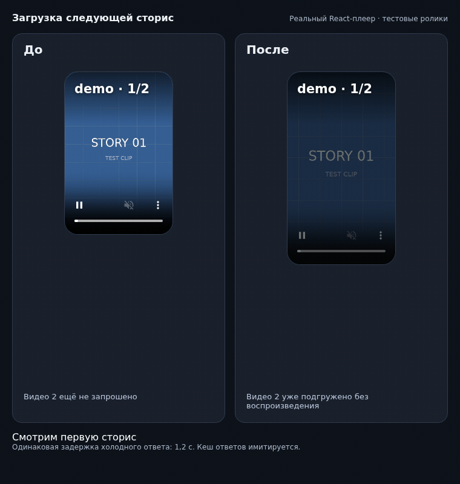

# Story loading before and after



The left pane uses the player, queue hook, and styles from `5a212ab`.
The right pane uses the working tree. These are isolated mounts of the actual
React player and review prefetch hook, using identical silent synthetic clips.
The 2:3 clips exercise metadata-driven resizing inside the 9:16 story frame.

Playwright delays each URL's first response by 1.2 seconds and serves subsequent
requests from a fixture-managed response cache. Both panes switch together.
This demonstrates request order and rendering with a controlled response cache;
it does not measure browser HTTP cache reuse or production network performance.

The capture asserts that only the updated version requests the second video
before navigation, both versions display the second story, and neither reports
a playback or JavaScript error.

To regenerate, install the npm dependencies, Chromium, and ffmpeg, then run:

```sh
npx playwright install chromium
node scripts/demo-story-loading.mjs 5a212ab
```

The GIF, captured frames, clips, and request log are written to
`test-results/story-demo/`. No application server or credentials are used.
